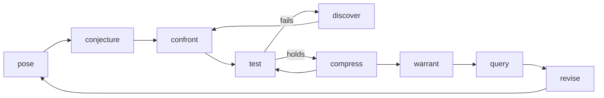

<p align="center">
  
</p>

robert is the method layer of an AI simulation scientist. It packages what a
simulation scientist does as tools that any coding agent can call, and it leaves the
simulation itself to [stochadex](https://github.com/umbralcalc/stochadex). The agent
does the implementation, and the experienced user supplies judgment where the work
is new. Every point where the user had to step in is logged.

It is built to test one claim: how far can simulation science be automated?
The [design doc](https://claude.ai/artifact/XXXKh76eufzP1Jidwmq1mo) has the full
argument.

## Questions and answers

The user asks questions; robert answers them. Each question is an **experiment**
(`experiments/E###.yaml`): the question, robert's answer, every assumption the answer
rests on (the user's, and robert's own build choices), the evidence behind every
number, and follow-up questions robert suggests. A follow-up taken up becomes the next
experiment, and the chain of experiments is the context robert builds on for deeper
questions. Every answer also states the strongest case against itself, lists every
analysis tried, and reports on the project's standing questions, which are the channel
for surprises nobody thought to ask about. robert decides implementation choices
itself, states its operationalisation choices where you can contest them, and asks
what you believe about the world only when an answer depends on it.

| Tool | Does |
| --- | --- |
| `ask` | Opens an experiment for a question, or for a suggested follow-up (`--from-follow-up E002.1`) |
| `answer` | Records the answer; the gate checks assumptions, evidence and follow-ups |
| `context` | What earlier experiments established, compressed; with `--focus`, a chain in full |
| `standing` | The questions every answer must report on: contradictions, surprises, operationalisation choices |

The discovery-and-warrant loop below is how robert earns each answer.

## The loop



| Step | Writes | Gate before moving on |
| --- | --- | --- |
| `init` | repo skeleton, `domain.yaml` | Domain interview complete |
| `pose` | `claim.yaml` | Question, claim, intended use and conditions named |
| `conjecture` | `model/partitions.yaml`, lineage root | `stochadex --check`; twice-run harness; a role and hypothesis per partition; observables mapped; input licences |
| `confront` | `ledger/beliefs.jsonl` | Posterior converged; weak identifiability flagged |
| `test` | `tests.yaml` verdicts | Every structural partition passed; a backtest ran |
| `discover` | a variant in `model/lineage.yaml` | Beats its parent on held-out prediction; ladder rule for learned partitions |
| `compress` | a smaller variant | Claim metric unchanged within tolerance; generalisation |
| `warrant` | `ledger/warrants.jsonl` | Current variant tested and passed; limits stated |
| `query` | `queries/<id>.yaml` | The warrant reaches the mode's rung |
| `revise` | `revise.yaml` | Monitors watch partitions and name their action |

The supporting commands are `run`, `graph`, `plot`, `status`, `explain`, `intervene`
and `doctor`. Every command is also an MCP tool with the same arguments, so a
project driven through chat leaves the same trail as one driven by hand.

## Install

```bash
curl -fsSL https://raw.githubusercontent.com/umbralcalc/robert/main/install.sh | sh
```

The installer puts the `robert-ai` package in an isolated tool environment, using uv
if you have it, then pipx, and otherwise it installs uv first. It then runs
`robert setup`, which:

- downloads the stochadex release robert locks into `~/.robert/stochadex/<version>/`
  and checks it against the SHA-256 recorded in `robert/stochadex.json`;
- installs the Claude Code plugin (both skills and the MCP server) when `claude` is
  on PATH, and adds the MCP server to `~/.cursor/mcp.json` when Cursor is installed.

Run `robert doctor` at any time to check the toolchain. Re-running `robert setup`
repairs or upgrades the install, and `robert setup --accelerated` swaps in the BLAS +
DuckDB build of stochadex. Set `ROBERT_VERSION=0.2.0` to install a specific release,
or `ROBERT_NO_AGENTS=1` to skip agent registration.

To try unreleased changes, install from GitHub instead:

```bash
curl -fsSL https://raw.githubusercontent.com/umbralcalc/robert/main/install.sh | ROBERT_SOURCE=git+https://github.com/umbralcalc/robert sh
```

### How robert depends on stochadex

robert never bundles stochadex. It locks one release and declares the range it
supports, in [robert/stochadex.json](robert/stochadex.json):

| Rule | Effect |
| --- | --- |
| Resolution order | `STOCHADEX_BIN`, then the managed install of the wanted version, then PATH |
| Version range | Any binary outside the supported range is refused, with the fix |
| Checksums | A download that doesn't match the lock (or the release's `SHA256SUMS`) is never installed |
| Project pin | Each project records the stochadex version it was created with; `doctor` flags drift |
| Updates | A weekly workflow moves the lock to the newest release, tests it, and opens a PR |

robert needs stochadex v0.24 or later: it renders the partition graph with
`stochadex graph`, and checks its skills against `stochadex catalogue`, the JSON list
of everything a build can run.

## Connect an agent

`robert setup` already registers Claude Code and Cursor. To do it by hand:

| Agent | How |
| --- | --- |
| Claude Code | `claude plugin marketplace add umbralcalc/robert`, then `claude plugin install robert@robert`. This adds both skills and the MCP server. |
| Cursor | Add `adapters/cursor/mcp.json` to `~/.cursor/mcp.json`, and copy `adapters/cursor/rules/` into a project's `.cursor/rules/`. |
| Anything else | Point it at `adapters/agents/AGENTS.md` and run `robert mcp` as a stdio MCP server. |

Every project that `robert init` creates also contains its own `.mcp.json`,
`.cursor/mcp.json`, `AGENTS.md` and `.devcontainer/`, so any agent opened in it
finds the tools.

The skills in `skills/` are the single source of method content. After you edit
one, run `robert adapters` to regenerate the Cursor rules, `AGENTS.md` and the
plugin manifest. CI fails if they drift.

## In the cloud

| Route | How |
| --- | --- |
| Image | `ghcr.io/umbralcalc/robert:<version>` contains robert, the locked stochadex (accelerated build), Python and git. Run `docker run --rm -it -v "$PWD:/work" ghcr.io/umbralcalc/robert status`. |
| Dev container / Codespaces | Projects from `robert init` open in the robert image. For any other repo, add the feature `"ghcr.io/umbralcalc/robert/robert:0": {}` to its `devcontainer.json`. |
| robert as a cloud agent | A Managed Agents agent whose tools run in a fresh, locked-down sandbox from the robert image on your own host, with egress limited to each project's licensed data hosts. See [cloud/README.md](cloud/README.md). |
| Other cloud coding agents | Use the one-line installer with `ROBERT_NO_AGENTS=1` as the environment's setup script, or start the agent in the robert image. |
| MCP over the network | `robert mcp --http` serves streamable HTTP at `http://127.0.0.1:8765/mcp`. Binding to anything else requires a bearer token: `ROBERT_MCP_TOKEN=... robert mcp --http --host 0.0.0.0`. |

## Releases

Versions follow SemVer, pre-1.0, so a minor bump may break the CLI, the tool
schemas or the file contracts. [CHANGELOG.md](CHANGELOG.md) has the policy.
`robert/__init__.py` holds the only version number; the package, the plugin
manifests and every project's recorded skills version all read it.

To release, run the **Prepare release PR** workflow with the new version. It turns
the `[Unreleased]` changelog section into the release and bumps the version. Review
and merge that PR. `tag-release.yml` then tags the merge commit, and `release.yml`
tests and publishes:

- the `robert-ai` package to PyPI, through a trusted publisher;
- the GitHub Release, with the changelog section as its notes;
- the image to GHCR, for amd64 and arm64;
- the Dev Container Feature.

## Worked example

```bash
examples/logistic-growth/walkthrough.sh /tmp/logistic-demo
```

This runs the whole loop against real stochadex runs:

1. Unconstrained growth fails its backtest and its density-dependence process check.
2. The user's redirect is logged.
3. `discover` adds a carrying capacity, which beats its parent on held-out years.
4. `compress` removes a seasonal nuisance without moving the claim.
5. A forecast is warranted and queried.
6. A `decide` query is refused, because no model-part swap was tested on the action path.

## Design principles

- **One hard boundary.** Determinism is enforced at the stochadex run. The agent
  is free in everything it writes above it, and restriction comes from checks,
  not templates.
- **Build on stochadex, not beside it.** `model/sim.yaml` is a pure stochadex
  config. Validation, I/O manifests, provenance and the partition graph all come
  from the stochadex CLI. robert adds only the claim, the per-partition roles and
  hypotheses, the lineage, the tests, the ledger and the gates.
- **The agent never produces a number.** Every figure traces back to a config, a
  seed and a provenance sidecar.
- **Mechanism first.** Learned (ONNX) components must earn their place through
  `discover`, after mechanistic variants have failed and the user has approved.
- **Gates live in the MCP server, never in agent hooks**, so every agent is held
  to the same standard.

## Repository layout

| Path | What |
| --- | --- |
| `robert/` | The method CLI and MCP server (`tools.py` is the single registry) |
| `robert/stochadex.json`, `robert/deps.py` | The stochadex lock, resolver and installer |
| `install.sh`, `Dockerfile`, `devcontainer-features/` | Install routes: one line, image, dev container |
| `assets/` | The robert logo |
| `skills/simulation-scientist/` | The method skill |
| `skills/stochadex-model/` | The model-authoring skill, moved from stochadex v0.23.0 |
| `adapters/`, `.claude-plugin/` | Generated per-agent adapters |
| `examples/logistic-growth/` | The end-to-end worked example |
| `tests/` | Unit tests, plus the whole loop against a real stochadex |

## Testing

```bash
pip install -e '.[dev]'
```

```bash
robert setup --no-agents
```

```bash
pytest
```

The loop and recipe tests skip when no supported stochadex is installed.
