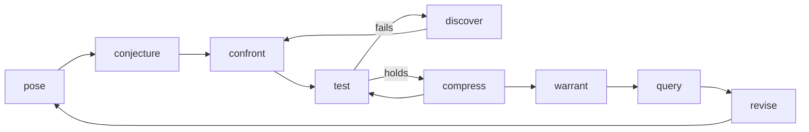

# robert

The AI scientific research developer powered by simulations.

robert is the method layer of an AI simulation scientist. It packages what a
simulation scientist does as tools that any coding agent can call, and it leaves the
simulation itself to [stochadex](https://github.com/umbralcalc/stochadex). The agent
does the implementation, and the experienced user supplies judgment where the work
is new. Every point where the user had to step in is logged.

It is built to test one claim: how far can simulation science be automated?
The [design doc](https://claude.ai/artifact/XXXKh76eufzP1Jidwmq1mo) has the full
argument.

## The loop



| Step | Writes | Gate before moving on |
| --- | --- | --- |
| `init` | repo skeleton, `domain.yaml` | Domain interview complete |
| `pose` | `claim.yaml` | Question, claim, intended use and conditions named |
| `conjecture` | `model/partitions.yaml`, lineage root | `stochadex --check`; twice-run harness; a role and hypothesis per partition; observables mapped; input licences |
| `confront` | `ledger/beliefs.jsonl` | Posterior converged; weak identifiability flagged |
| `test` | `tests.yaml` verdicts | Every structural partition passed; a backtest ran |
| `discover` | a variant in `model/lineage.yaml` | Beats its parent on held-out prediction; ladder rule for learned partitions |
| `compress` | a smaller variant | Claim metric unchanged within tolerance; generalisation |
| `warrant` | `ledger/warrants.jsonl` | Current variant tested and passed; limits stated |
| `query` | `queries/<id>.yaml` | The warrant reaches the mode's rung |
| `revise` | `revise.yaml` | Monitors watch partitions and name their action |

The supporting commands are `run`, `graph`, `plot`, `status`, `explain`, `intervene`
and `doctor`. Every command is also an MCP tool with the same arguments, so a
project driven through chat leaves the same trail as one driven by hand.

## Install

robert needs the stochadex CLI and `stochadex-graph`, pinned to the version in
`robert/__init__.py` (currently v0.23.0):

```bash
git clone --branch v0.23.0 https://github.com/umbralcalc/stochadex /tmp/stochadex
```

```bash
(cd /tmp/stochadex/cmd/stochadex && CGO_ENABLED=0 go build -o ~/.local/bin/stochadex .)
```

```bash
(cd /tmp/stochadex && go build -o ~/.local/bin/stochadex-graph ./cmd/stochadex-graph)
```

Then install robert and check the toolchain:

```bash
pip install -e '.[dev]'
```

```bash
robert doctor
```

## Connect an agent

| Agent | How |
| --- | --- |
| Claude Code | `/plugin marketplace add umbralcalc/robert`, then install `robert`. This adds both skills and the MCP server. |
| Cursor | Copy `adapters/cursor/rules/` into `.cursor/rules/` and `adapters/cursor/mcp.json` into `.cursor/mcp.json`. |
| Anything else | Point it at `adapters/agents/AGENTS.md` and run `robert mcp` as a stdio MCP server. |

Every project that `robert init` creates also contains its own `.mcp.json`,
`.cursor/mcp.json` and `AGENTS.md`, so any agent opened in it finds the tools.

The skills in `skills/` are the single source of method content. After you edit
one, run `robert adapters` to regenerate the Cursor rules, `AGENTS.md` and the
plugin manifest. A test fails if they drift.

## Worked example

```bash
examples/logistic-growth/walkthrough.sh /tmp/logistic-demo
```

This runs the whole loop against real stochadex runs:

1. Unconstrained growth fails its backtest and its density-dependence process check.
2. The user's redirect is logged.
3. `discover` adds a carrying capacity, which beats its parent on held-out years.
4. `compress` removes a seasonal nuisance without moving the claim.
5. A forecast is warranted and queried.
6. A `decide` query is refused, because no model-part swap was tested on the action path.

## Design principles

- **One hard boundary.** Determinism is enforced at the stochadex run. The agent
  is free in everything it writes above it, and restriction comes from checks,
  not templates.
- **Build on stochadex, not beside it.** `model/sim.yaml` is a pure stochadex
  config. Validation, I/O manifests, provenance and the partition graph all come
  from the stochadex CLI. robert adds only the claim, the per-partition roles and
  hypotheses, the lineage, the tests, the ledger and the gates.
- **The agent never produces a number.** Every figure traces back to a config, a
  seed and a provenance sidecar.
- **Mechanism first.** Learned (ONNX) components must earn their place through
  `discover`, after mechanistic variants have failed and the user has approved.
- **Gates live in the MCP server, never in agent hooks**, so every agent is held
  to the same standard.

## Repository layout

| Path | What |
| --- | --- |
| `robert/` | The method CLI and MCP server (`tools.py` is the single registry) |
| `skills/simulation-scientist/` | The method skill |
| `skills/stochadex-model/` | The model-authoring skill, moved from stochadex v0.23.0 |
| `adapters/`, `.claude-plugin/` | Generated per-agent adapters |
| `examples/logistic-growth/` | The end-to-end worked example |
| `tests/` | Unit tests, plus the whole loop against a real stochadex |

## Testing

```bash
pytest
```

The loop and recipe tests run only when `stochadex` and `stochadex-graph` are on
PATH, or set through `STOCHADEX_BIN` and `STOCHADEX_GRAPH_BIN`.
