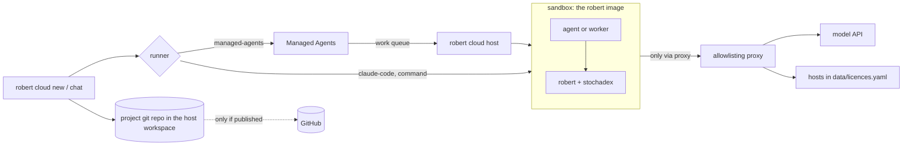

# robert in the cloud

One locked-down sandbox, any agent. Each run gets a fresh container from the robert
image, so every run is also a clean-install test of the pinned robert and stochadex.
Only the agent driving the work changes between runners, which is what the a2a
experiment needs: the same image, egress rules, repo handling, instructions and
gates for every agent.



## Runners

| Runner | The agent loop runs in | Model credentials | Needs |
| --- | --- | --- | --- |
| `managed-agents` | Anthropic; our host runs its tools in the sandbox | Never in the sandbox | `ant apply`, an environment key, `robert cloud host` running |
| `claude-code` | Claude Code, headless, in the sandbox | `ANTHROPIC_API_KEY`, passed into the sandbox | The `robert-claude-code` image |
| `command` | Any agent CLI, in the sandbox | The variables you list, passed in | An image and a command template you configure |

Every runner drives robert through the same `robert` CLI, with the same
instructions ([robert/cloud/instructions.md](../robert/cloud/instructions.md),
which is also the Managed Agents system prompt) and the skills baked into the image
at `/opt/robert/skills`. A CLI runner's conversation history lives in
`~/.robert/cloud/state/<project>/<runner>/` on the host, so each turn's fresh
container continues the last one.

## The sandbox

- **Fresh each time:** read-only root filesystem, non-root user, no Linux capabilities, and limits of 2 CPUs, 4 GB and 512 processes.
- **Network:** an internal Docker network whose only way out is a squid proxy. It allows the runner's model API and the hosts in each project's `data/licences.yaml`, and nothing else; see its log with `docker exec robert-egress tail /var/log/squid/access.log`. Managed Agents' server-side web tools are off, so they can't bypass it.
- **Project:** a git repo in the host workspace (`~/.robert/cloud/projects/<project>`), mounted at `/workspace/<project>`. The agent commits there. Nothing leaves the host unless you publish the project: `new --github` at the start, or `robert cloud publish <project>` later, creates a private GitHub repo, and from then on the host pushes after each turn with its own credentials. No credential enters a sandbox either way.

Limits of this first version:
- Concurrent sessions share one proxy, so its allowlist is the union of the active projects' hosts.
- A CLI runner's API key, and the managed-agents environment key, are inside the sandbox. The proxy limits where they can be sent, but rotate them if a sandbox is ever compromised.
- CLI runners start their sandboxes from the machine you chat on, so chat on the host.

## Bring it up

Common to every runner: Docker running and robert with the cloud extra. `gh` signed in is needed only to publish projects to GitHub:

```bash
pip install 'robert-ai[cloud]'
```

```bash
robert cloud configure
```

### managed-agents

```bash
brew install anthropics/tap/ant
```

```bash
ant auth login
```

1. Create the agent and environment from the repo root. Review the plan, then apply it, and commit the `claude-lock.json` it writes:

   ```bash
   ant apply --dry-run cloud/agents/robert
   ```

   ```bash
   ant apply cloud/agents/robert
   ```

2. Record the IDs:

   ```bash
   robert cloud configure --lock claude-lock.json
   ```

3. Generate an environment key in the Console, on the `robert-self-hosted` environment's page. Then, in a terminal that stays open:

   ```bash
   ANTHROPIC_ENVIRONMENT_KEY=<the key> robert cloud host
   ```

4. In another terminal:

   ```bash
   robert cloud new my-project --description "the question, in your words"
   ```

### claude-code

```bash
ANTHROPIC_API_KEY=<your key> robert cloud new my-project --runner claude-code --description "the question, in your words"
```

### command

Add the agent to `~/.robert/cloud/config.yaml`, with an image built on the robert image that has the agent CLI installed:

```yaml
runners:
  command:
    image: my-agent-on-robert:1
    command: [my-agent, --non-interactive, "{message}"]
    continue_command: [my-agent, --non-interactive, --resume, "{message}"]
    hosts: [api.my-model-provider.com]
    env: [MY_PROVIDER_API_KEY]
```

Reopen any project with `robert cloud chat my-project`.

To move the host to a VM, install the same things there, copy `~/.robert/cloud/`, and run the host and your chats on the VM.
